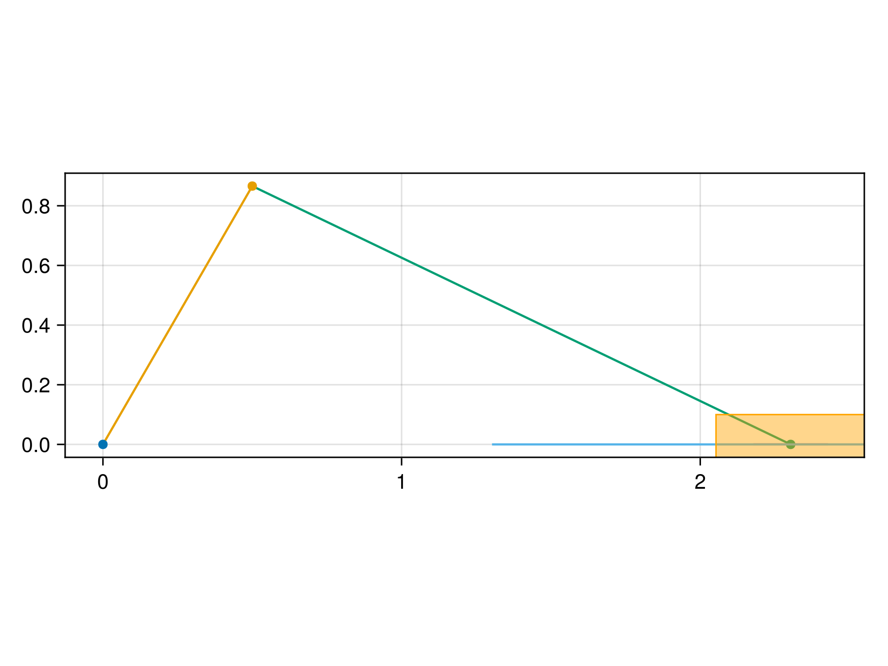

# Примеры

В каталоге `examples/` лежат готовые сценарии. Они же — лучшие шаблоны для
своих задач: скопируйте ближайший по смыслу файл и поменяйте параметры.

Запуск из корня клона:

```powershell
julia --project=examples -e 'using Pkg; Pkg.instantiate()'
julia --project=examples examples/simple_example.jl
julia --project=examples examples/crankshaft.jl
```

Каждый сценарий активирует окружение `examples/` самостоятельно, но пути
результатов (`out/...`) считаются от текущего каталога, поэтому запускайте из
корня клона. Видео попадают в `out/`; этот каталог игнорируется гитом.

{#fig-crank-slider width=75%}

## Каталог сценариев

| Файл | Что показывает |
| --- | --- |
| `simple_example.jl` | минимальный маятник: заделка, шарнир, гравитация, запись видео |
| `pendulum.jl` | шестизвенный механизм с двумя заделками и тремя крутильными пружинами |
| `crankshaft.jl` | кривошипно-ползунный механизм: шарниры, ползун, мотор, линейная пружина |
| `crankshaft_link2d.jl` | тот же механизм, но звенья нарисованы `Link2DVisual` |
| `inclined_surface.jl` | ползун на наклонной направляющей под действием гравитации |
| `slinear_spring_example.jl` | масса на линейной пружине вдоль горизонтальной направляющей |
| `sensor_example.jl` | все четыре типа датчиков и графики измерений |
| `linear_actuator.jl` | позиционный линейный привод; сверка `λ` с аналитикой |
| `inverse_pendulum_control.jl` | обратный маятник на ползуне с обратной связью в `prestep` |
| `d_pend_torq.jl` | двойной маятник с моментным приводом и реверсом цели |
| `stat_bar.jl` | статика трёхзвенной цепи: реакции, моменты пружин, сохранение решения |
| `diag_bars.jl` | восьмизвенная цепь с двумя заделками и пружинами |
| `parmech.jl` | параллельный механизм из кривошипов и стола |
| `real_5bar.jl` | пятизвенный механизм с реальными массами и моментами инерции |
| `hinge_with_drift.jl` | контур звена через `MeshVisual`, поведение шарнира |
| `test_forward_kinematic.jl` | прямая кинематика: `kinematic_constrains!` и визуализация одного состояния |
| `fixed_joint_attachment.jl` | геометрия штриховки заделки: `FixedVisual` со своим `Attachment` |

## Чему учиться в примерах

- **Сборка системы** — `simple_example.jl`: тела, связи, `assemble!`, начальное
  состояние, интегрирование.
- **Сложные механизмы** — `crankshaft.jl`, `real_5bar.jl`, `parmech.jl`:
  комбинация шарниров, ползунов, пружин и приводов.
- **Приводы** — `linear_actuator.jl` и `inverse_pendulum_control.jl`:
  `prestep`, согласованные цель и её производная.
- **Статика** — `stat_bar.jl`: `static_solver!`, реакции через `get_lms`,
  моменты пружин, сохранение матрицы решения.
- **Датчики** — `sensor_example.jl`: `sys.measure!` и графики.
- **Визуализация** — `crankshaft_link2d.jl`, `hinge_with_drift.jl`:
  визуальные компаньоны и пользовательские формы.

## Что стоит знать, запуская примеры

- Первый запуск долгий: Makie компилируется.
- `GLMakie` требует дисплея; в примерах используется `CairoMakie`.
- Часть сценариев печатает `Assembling failed!` — это исторический артефакт
  проверки `assemble!` на истинность: функция ничего не возвращает, поэтому
  сообщение выводится всегда. На расчёт оно не влияет.
- `real_5bar.jl` пишет `triv_dyn.mp4` в корень репозитория, а не в `out/`.
- `framerate` в `record` должен быть целым числом; некоторые примеры передают
  `Float64`, Makie округляет и предупреждает.
- Демпфирование `LinearSpring` пока не действует (см. главу «Силы»).
